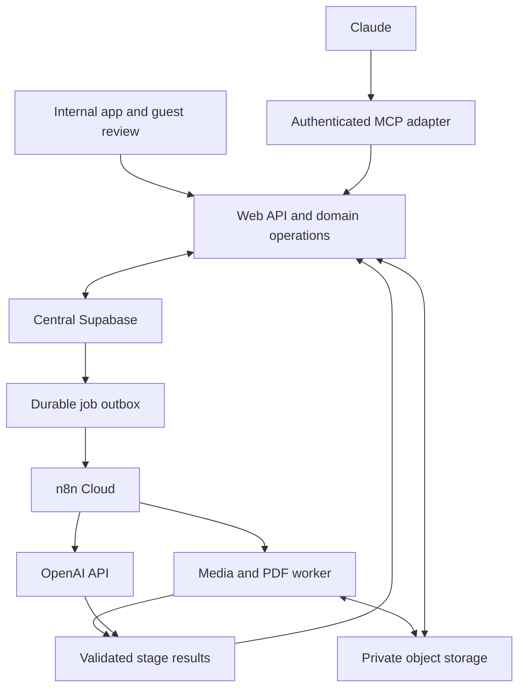

# Technical architecture

Version 1.0 • Proposed implementation architecture; cloud discovery pending

## 1. Architectural shape

Use a modular TypeScript web/API application with a separate containerized media/render worker. Supabase is the central persistent source of truth for business identities, casting data, authorization mappings, job state and media metadata. Private object storage holds originals and derived files. Existing n8n Cloud orchestrates asynchronous workflows. OpenAI provides extraction/transcription/wording capabilities. Claude operates the same domain operations as the UI through authenticated MCP.

The outbox is an application table and dispatcher, not a claim that Supabase magically runs a workflow. M02 implements the dispatcher, lease renewal, retries and reaper for specs; M03 reuses it for video. n8n's execution ID is diagnostic; durable job status belongs to Supabase. Large binary assets travel between storage and authorized workers/providers, not through every API request or workflow node.

## 2. Repository and dependency boundaries

| Planned area | Responsibility | Must not own |
|---|---|---|
| `apps/web` | Next.js app, authenticated routes, guest viewer, API and MCP adapters | A second copy of domain casting rules |
| `apps/worker` | FFmpeg/ffprobe, document conversion where needed, frame extraction, Playwright PDF, isolated temp files | User permissions inferred from arbitrary callback input |
| `packages/domain` | Use cases, authorization checks, transactions, lifecycle rules, validation | UI components, provider-specific prompts |
| `packages/contracts` | HTTP/MCP DTOs, JSON schemas, typed errors/events | Database access |
| `packages/integrations` | Central Supabase adapters, storage, OpenAI, n8n dispatch | Presentation decisions such as automatic Shortlist |
| `packages/templates` | Versioned shared browser/print layouts and template measurements | Reading mutable library facts during saved rendering |
| `supabase` | Local config, coordinated migrations, fixtures, DB assertions | Divergent independent migration history for the shared cloud DB |
| `n8n` | Exported workflow definitions, setup notes, credential names without secrets | The only copy of business validation |
| `tests` | Contract/domain/DB/browser/worker/live-service acceptance | Real personal data committed as fixtures |
| `docs` | This pack, discovery records, progress and handoff | Unverified completion claims |

Keep route handlers thin: authenticate, parse, call operation, serialize. Domain operations accept an actor context with resolved principal, capabilities, resource scope, request ID and idempotency context. Internal UI may call the same service directly server-side, but it must preserve the same authorization and validation as HTTP/MCP. Avoid creating UI-only actions with no operation contract.

## 3. Central business integration

M00 inventories existing schemas, relations, keys, RLS, triggers, functions, migrations, memberships, auth issuers and buckets read-only. The app must reuse existing projects and clients. It must reuse people/cast records and shared fields where those already represent the same entity reliably. No production project is created by importing a filename or typing an unlinked name.

`integration_bindings` is an identity map when a stable app UUID is necessary across heterogeneous canonical keys. It contains source locator/key and verified identity, not a parallel project/client name store. Prefer actual FK integrity to canonical tables where ownership and types allow it. The discovered adapter supplies a projection for UI reads and routes authorized edits to the canonical owner. Record exact field ownership in the schema mapping. If a canonical source already owns candidate height or city, do not add a competing eps truth for it.

A local synthetic central adapter allows isolated development when cloud access is not yet available; it is labelled development-only. Production start must fail if that adapter is enabled. Tests assert that non-existent, inaccessible and archived source projects cannot be bound. The reference SQL in this pack describes proposed tables; it is not a production migration and must not be applied to the shared database unchanged.

## 4. Data ownership and read models

Separate five concerns. A candidate has reusable facts and source evidence. A media asset has immutable content identity, storage location, processing lifecycle and derivatives. A workspace-candidate relation picks project material and project availability. An assignment links that candidate to a specific slot with casting position, explicit Shortlist and presentation wording. A generated version captures its complete render input.

A library correction affects future draft reads and future generated versions. It does not rewrite old pages. Replacing project media affects that workspace's future generation, not other projects. A candidate appearing twice in a deck receives independent assignment snapshots even when the reusable facts are shared. Sharing a series grants access to the version-approved projection, not every field on the live candidate.

Use row versions for optimistic concurrency. A stale UI/Claude edit returns `409 stale_version` with a safe refresh path. Source-processing completion must also compare the profile/spec revision it was based on so a late AI result does not overwrite reviewed user edits. This is a concurrency rule, not a dedicated fact-conflict product.

## 5. Upload and processing pipeline

1. Authorized caller requests an upload session with project purpose, filename, claimed MIME/size and optional known candidate.
2. API validates allowed purpose and scoped destination; bytes upload directly through resumable storage transport.
3. Completion verifies the actual stored object, size, type and content hash. An upload request alone is not proof the file arrived.
4. In one durable transaction, mark ready-to-process, create per-file jobs and outbox records. If transaction or dispatch fails, a retry cannot create a second candidate/job.
5. Dispatcher sends only IDs and time-scoped asset access to n8n. n8n requests worker preparation, OpenAI transcription/extraction and worker frame work, with bounded concurrency.
6. Each stage claims a lease/attempt, reports heartbeats and completes through an authenticated callback. Results are schema-validated and scoped to the authorized job before any state change.
7. Commit usable output, link media, create Unreviewed profile if appropriate, update draft change summary. Existing candidate attachment waits for explicit duplicate decision when required.
8. Terminal failures remain actionable independently. A silent video can still produce a profile with missing facts and available frames. Corrupt data cannot be disguised as successfully scanned.

A later per-file failure must not roll back earlier candidates in the batch. Use timeout, backoff with jitter, retry classification and maximum attempts per stage. Enforce fencing tokens to reject a late callback from a superseded attempt. Cancellation stops new dispatch and ignores late commits; provider work already in progress may still incur cost. Track this honestly.

## 6. Native worker boundary

n8n Cloud does not provide the Execute Command node [S04](../../SOURCES.md#s04). FFmpeg/ffprobe, protected file decoding, image generation from actual timestamps, Word conversion and Chromium rendering therefore run in a worker container. Next.js route handlers receive requests and return job IDs; they are not long-running transcoding processes [S01](../../SOURCES.md#s01).

Worker requests use allowlisted job and asset IDs; workers resolve storage through controlled services. Never accept arbitrary shell command strings, arbitrary remote URLs, file system paths or Chromium navigation targets. Generate subprocess argument arrays rather than shell concatenation. Run as a non-root user with bounded CPU/memory/time, temporary per-job directory, controlled egress, MIME sniffing and clean-up. Render templates from known local application code and escaped data; HTML/script from uploaded documents is data, not executable markup.

For frames, retain source asset ID and timestamp/hash. Assess clarity/distinctness from available footage; technical quality checks may use image processing/vision, never inferred demographic attributes. Users can choose other real timestamps. No process synthesizes or beautifies a candidate's appearance.

## 7. Deterministic presentation generation

Generation first validates the workspace revision and calculates pages. It allocates a version number in a transaction and stores a complete frozen manifest: canonical project/client text, branding asset references, output, audience snapshot, requirements, ordered slots/assignments, all ten fields, display wording, selected frames and original video identity, template version and generation actor.

The browser and PDF read this manifest through the same versioned template components. They do not query live profile facts while rendering. Chromium waits for local fonts and images before PDF capture. Exact print CSS, image aspect containment, page dimensions, no clipped field and accessible linked media are contract requirements. PDF completion stores checksum/size/page count and changes status to ready only after validation.

Ready-pointer update is monotonic by version number. If V3 finishes before V2, V2 finishing later must not move a review link back to V2. Failed V4 leaves V3 available. A retry of V4 uses the frozen V4 manifest; editing the working draft creates another version, not a changed V4. Changes to template code require a new version identifier with deterministic historical render handling.

## 8. Sharing, guest identity and media

Review links contain high-entropy bearer credentials stored as digests permanently. Creation returns the raw value for immediate Copy; encrypted short-lived idempotency-response replay is the narrow exception documented in the security contract and must expire/delete. Later replacement uses explicit rotation. Link viewing validates scope, expiry and revocation; PDF prepare/download additionally checks download permission. Exchange the token for a constrained session where appropriate, with no-store responses and referrer/log hygiene. Guest identity is a remembered display name plus separate opaque session identity for editing their own responses. It does not grant internal app/library access.

The review page opens the latest ready version in the link's series; feedback writes explicitly include the viewed version/slide. If a new version arrives while a guest is reading, show an update choice rather than relocating the guest mid-comment. Other guests' external feedback in that presentation remains visible; internal notes never enter guest payloads.

Stable PDF media URLs identify their fixed version and asset and validate access at request time. Prefer an authorized stream/proxy for strict request-time revocation. If short-lived storage URLs are used for playback, record and test the maximum expiry window: an issued URL remains usable until expiry [S09](../../SOURCES.md#s09). Neither approach can revoke bytes already downloaded. Guest PDF generation/download must embed a review-authorized playback route rather than an internal-only link or a cloud storage expiry URL.

The canonical internal PDF is stored on the generated version and uses authenticated media routes. Guest downloads use `presentation_exports`, a cached link-scoped variant of the same frozen content. The worker obtains a one-time random `review_media_grants` credential, persisted as a digest and bound to parent link plus fixed version, and embeds `/m/:grantToken/versions/:versionId/media/:assetId`. The cache preserves the PDF without reconstructing its token. No raw token enters job/outbox/logs. Expiry edits propagate to non-revoked grants; revoke/rotation invalidate old access and affected export cache. Download-disable denies new PDF preparation/download but does not revoke still-authorized viewing through an already downloaded PDF. Failed render grants are revoked. These URL differences never change saved candidate content.

## 9. API/MCP and identities

Every business action has a named operation and typed request/response. MCP tools map to those operations and share idempotency, concurrency and permission behavior. An agent may confirm facts, set Main, include Shortlist, generate, export and manage links if the represented user can. Do not add a human-only check to `confirm_candidate_reviewed` or generation.

Remote MCP uses the current compatible SDK, Streamable HTTP and supported authorization. Discover auth compatibility with existing business sign-in; internal Supabase login and MCP OAuth are related integrations, not automatically the same mechanism [S12](../../SOURCES.md#s12). Agent token scope is explicit, delegated and auditable; no service-role key is provided to Claude. A complete operation catalog is designed early; M07 completes external client wiring, documentation and real end-to-end parity testing.

## 10. Resilience and observability

Use request → job → stage → attempt → provider execution IDs for correlation. Store provider/model/prompt/schema versions, processing seconds, byte counts and measured cost where available. Do not log raw link tokens, JWTs, storage credentials, complete personal transcripts or media payloads. Keep actionable redacted error codes for users and richer restricted diagnostics for operators.

The source of truth is the DB, so workers may restart without losing job intent. The outbox dispatcher leases and retries deliveries; stage commits deduplicate effects. A scheduled reaper recovers expired leases and abandoned uploads without deleting referenced media. Backups and object storage restores are separate recovery concerns; a successful PostgreSQL restore alone does not prove video recovery. Demonstrate restore of metadata plus referenced files during M07.

## 11. Extension model

Represent presentation type in a registry: module ID, input schema/version, workspace route, allowed asset types, processing pipeline, review schema and template renderer. Casting implements this fully. Shared projects, storage, jobs, audiences, generated versions and review services remain generic where practical. Avoid prematurely replacing all typed casting tables with opaque universal JSON; preserve useful constraints and queries. New modules can reuse primitives while providing their own domain tables and pipeline.

## 12. Implementation authority

[Database contracts](../data/DATABASE_SCHEMA.md), [API contracts](../integrations/API_CONTRACT.md), [workflow specs](../../workflows/README.md) and [template specs](../experience/PRESENTATION_TEMPLATE.md) supply detailed execution rules. If M00 finds a genuine mismatch with the existing ecosystem, adapt the adapter/physical schema, document the decision and update all affected contracts before implementing divergent behavior. The agreed user-facing rules remain fixed.
