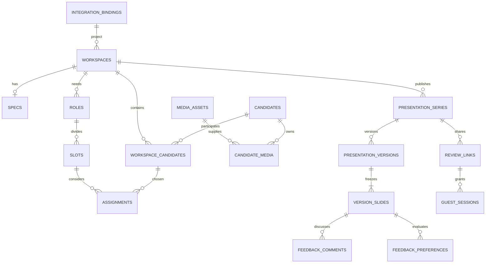

# Database schema and data dictionary

## M07 physical implementation overlay

Canonical/local history29 now contains `eps.app_settings` and the operator-owned `eps.mcp_oauth_resources`, with constrained Settings/own-session RPCs and forced RLS. This configuration does not duplicate projects/clients/people or rewrite Ready snapshots. [The physical mapping](../../contracts/database/central-schema-map.yaml) records the exact fields and [independent readback](../../tracking/evidence/cloud-m07-29/2026-10-30T11-52-36-310355Z-f553771a-readback.json) preserves old data/Auth/configuration. The logical design below is retained as the dated contract; its initial uninspected-state wording is historical, not the current discovery state.

**Status:** implementation design, version 1.0, 27 October 2026. The live Everyone Supabase schema has not been inspected. This document defines logical responsibilities and invariants, not a claim about existing tables. Read [the contract baseline](../../CONTRACT_BASELINE.md), [discovery and migrations](SUPABASE_DISCOVERY_AND_MIGRATIONS.md), [transaction contracts](TRANSACTION_FUNCTIONS.md), and [access controls](SECURITY_AND_ACCESS.md) together. Exact transport aliases and raw-to-search mappings are defined in [API/database mapping](../integrations/API_DB_MAPPING.md).

## 1. Ownership before table creation

The central business database remains authoritative for projects, clients, users/principals, and any suitable existing person/cast records. Milestone M00 maps every logical entity and field to its real owner. Reuse a suitable table or function before creating an equivalent. Add casting-specific extension records only for capabilities the shared database does not already provide.

`eps` is the proposed private application schema. Do not expose it directly through the public Supabase Data API. A discovered existing schema may be reused instead, with the mapping documented. Logical names below stay stable in domain contracts even if physical SQL names differ.

`integration_bindings` bridges an internal UUID to an actual canonical record when the existing key is a UUID, integer, composite key, or other opaque value. It contains identity and integration metadata only. It never becomes a second editable table of project or client names. Prefer a real, typed foreign key to the canonical table where its ownership and key allow one. Otherwise the binding adapter must validate existence and authorization on creation and sensitive operations; store the canonical locator in a trusted configuration, never accept arbitrary SQL identifiers from a client.

When an authorized user edits the project or client name, write through the discovered central owner. A generated presentation captures those names as historical output content; that is a deliberate immutable snapshot, not a competing live source.

### Domain boundaries

| Boundary | Owns | Must not own |
|---|---|---|
| Central project/client | Shared name, client relation, business project identity, canonical access | Presentation-specific cloned project records |
| Candidate profile | Reusable supplied facts, category, review status | Current project's availability or slot choice |
| Candidate media | Historical source videos, transcript references, frame assets | A mutable file that silently replaces media in an old presentation |
| Workspace candidate | One candidate's participation, availability, chosen project media | Main/Backup/Option for all roles at once |
| Assignment | One candidate in one slot, position, explicit Shortlist inclusion, notes and slide wording | Selection checkbox or candidate-global casting position |
| Presentation version | Frozen facts, branding, role requirements, media references, wording and ordering | A live join that changes after the producer generates |
| Review feedback | Version-specific reviewer opinion and comments | Casting decisions, booking approval, or profile fact corrections |

## 2. Shared conventions

- Internal entity IDs are UUIDs; API consumers treat every ID as opaque. Central keys are mapped, not coerced destructively into UUIDs.
- Persist timestamps as `timestamptz` in UTC. API timestamps use ISO 8601. Display the user's timezone, with Africa/Cairo as the initial default. A shoot date without a time stays a `date`; do not invent a timezone conversion for it.
- Mutable domain records have `created_at`, `updated_at`, `created_by`/`updated_by` principal bindings where applicable and an integer `row_version >= 1`. An accepted mutation increments the row version. Clients submit the version they edited; stale updates return `409 STALE_VERSION`.
- `NULL` means no supplied scalar value. Empty arrays mean no supplied items, not a negative fact. Empty form strings normalize to `NULL`. Do not store the display string `Not provided` in facts; the renderer supplies it.
- Text is Unicode. Preserve original Arabic/English transcript separately from English normalized presentation facts. User-entered English wording may differ from the full source transcript without destroying it.
- Use `numeric`, not floating point, for supplied measurements requiring exact decimal representation. Retain the source text/unit when normalization could lose meaning.
- A supplied age range is a stated range, not a date of birth. Store its observation/as-of date when supplied or determinable from source metadata; do not silently increase the age every birthday without a supplied birth date.
- Use archival flags for records referenced by generated versions. Cascading hard deletion must not remove presentation history or media still referenced by a version.
- JSONB is appropriate for typed, schema-validated requirements, facts not mapped to central columns, slide snapshots, and provider metadata. Queryable relationships and integrity constraints belong in explicit relational columns.
- Schema-level JSON validation and application schemas must agree. At minimum validate at the application boundary and at trusted workflow result ingestion; constrain basic object/array shapes in SQL. The reference SQL does not claim a JSON-schema extension is installed.

## 3. Logical relationship map

Jobs, events, outbox, idempotency, and audit records support these entities; they are not additional presentation types.

## 4. Table dictionary

Columns below are the logical minimum. Standard audit/version columns are implied for mutable tables unless stated otherwise. The companion [design reference SQL](../../contracts/database/design-reference.sql) makes the relational constraints concrete. M00 must reconcile it with the shared schema before turning any part into a migration.

### 4.1 `integration_bindings`

| Column | Type / rule | Purpose |
|---|---|---|
| `id` | UUID PK | Stable app-facing identity |
| `entity_kind` | project / client / principal / candidate | Prevents a client identity being used as a project |
| `source_system` | text; normally central Supabase | Identity namespace |
| `source_entity` | trusted adapter name | References the discovery map; not client-controlled SQL |
| `source_key` | JSONB object | Canonical PK components with their exact values/types |
| `source_key_fingerprint` | text, unique with kind/system/entity | Canonicalized key identity, computed server-side |
| `active` | boolean | Integration availability; not central authorization |
| `last_verified_at` | timestamptz nullable | Last existence validation |

No project/client names, central membership list, or shadow password store belongs here. An inactive or deleted central project prevents new workspace mutations according to its canonical lifecycle policy. Existing snapshots remain governed by that project's retention/access policy.

### 4.2 `workspaces`

| Column | Type / rule | Purpose |
|---|---|---|
| `id` | UUID PK | Casting workspace |
| `project_binding_id` | non-null binding of kind project | Existing central project required |
| `module_type` | `casting` in v1 | Later modules can share platform foundations |
| `status` | active / archived | Workspace lifecycle |
| `logo_asset_id` | nullable media FK | Chosen client logo; canonical brand asset may be reused |
| `logo_placement` | cover / every_slide | Default cover; preserved in version |
| `draft_revision` | bigint | Changes whenever presentation inputs change |

One active Casting workspace per canonical project. Enforce this with a unique partial index on `(project_binding_id, module_type)` where active. Do not persist user view state such as `last_seen_draft_revision` or the active output tab as one shared casting decision for everyone; it is shown here to make the distinction explicit. “What's new” can use audit/job events since a user's last seen revision without a new workflow product.

### 4.3 `specs`

| Column | Type / rule | Purpose |
|---|---|---|
| `id`, `workspace_id` | UUID PK; workspace unique | One stable working specification |
| `source_asset_id` | nullable media FK | Uploaded PDF/Word source |
| `source_text` | text nullable | Pasted original text or extracted source text |
| `input_kind` | pdf / docx / doc / text | Processing route |
| `extraction_status` | empty / queued / running / ready / failed | Technical processing state |
| `requirements` | JSONB object | Typed top-level instructions and scheduling facts |
| `clarifications` | JSONB array | Field/path, message, source location, status |
| `source_language` | text nullable | Original language metadata |

Require source asset or source text when submitting an extraction job, but an empty draft specification may exist while the user works. Ordinary corrections update this record and roles. There is no specification revision tree, comparison UI, or automatic reconciliation of changing briefs.

### 4.4 `roles`

`id`, `workspace_id`, `spec_id` (nullable for manually created roles), `name`, `headcount`, `requirements` JSONB, `sort_order`, `archived_at`.

`requirements` contains typed keys: `classification`, `scene_references[]`, `age_range` (original supplied range text), optional validated `age_min`/`age_max` search projections, `gender_requirement`, `appearance_performance` (original combined requirement), `languages[]`, `accents[]`, `skills[]`, `shoot_dates[]`, `shoot_location`, `availability_requirement`, `instructions`, and `clarification_fields[]`. Transport aliases `location`, `availability_requirements`, `other_instructions`, and role `category` map respectively to `shoot_location`, `availability_requirement`, `instructions`, and `classification`; do not lose their source wording when adapting. Unknown values stay null/empty. A role can reference several scenes. Headcount is a positive integer when known; an unspecified count defaults to one provisional slot marked Needs clarification, never a fabricated confirmed count. The UI must distinguish this implementation default from source information.

Role labels can repeat if genuinely different characters; identity is the UUID. Sorting is explicit and stable. Increasing a corrected count adds slots. Reducing a count archives the selected excess slots through an explicit operation, after preserving their existing assignments/history; do not silently delete occupied slots.

### 4.5 `slots`

`id`, `workspace_id`, `role_id`, `ordinal`, `label`, `requirements_override` JSONB object, `sort_order`, `archived_at`.

An active ordinal is unique within a role. Required slot count is represented by individual records, even if there is only one. Default labels include `Father 1`, `Waiter 1`, `Waiter 2`. Slot requirements inherit role requirements, with explicitly supplied slot overrides if needed. The renderer snapshots resolved requirements, not a mutable link alone. A composite FK enforces that a slot's role belongs to its workspace.

### 4.6 `media_assets`

`id`, `asset_kind`, `origin_workspace_id` nullable, `bucket`, `object_key`, `original_filename`, `mime_type`, `byte_size`, `sha256`, `status`, `parent_asset_id` nullable, `time_offset_ms` nullable, `width`, `height`, `duration_ms`, `metadata` JSONB, `uploaded_by`, `producing_job_id`, `producing_attempt_id`, `output_stage`, `output_key`, `archived_at`. Worker outputs are reserved under the active job attempt before upload and verified by a scoped completion operation; caller-supplied asset IDs alone do not prove an allowed output.

Kinds: `spec_document`, `candidate_video`, `audio_derivative`, `frame`, `client_logo`, `presentation_pdf`, `presentation_preview`, `presentation_manifest`, `transcript`, `candidate_support`, `preview_video`, `document_text`, `document_page`. API purposes `specs`, `candidate_frame`, and `audio` map to `spec_document`, `frame`, and `audio_derivative`; remaining purposes use their documented direct mapping. Statuses: `uploading`, `ready`, `failed`, `quarantined`, `archived`. Use job state for extraction progress rather than confusing a successfully stored video with a failed transcript.

Each upload/derivative gets a new immutable object key. `(bucket, object_key)` is unique. Validate the actual file, not only its extension or browser-declared MIME. `parent_asset_id` + `time_offset_ms` records where a real video frame came from. Frame extraction or crop can create a new derivative; it never fabricates a face or body view. An upload reservation can live in `metadata.upload` with a typed expiry/resume identifier; if the existing platform has an upload-session table, reuse it. Never include credentials or signed URLs in metadata.

Assets may be reachable from both an authorized library profile and a project. An origin project does not make every asset globally visible; the authorized candidate-library relation supplies a separate access path. Private notes/specs do not become library media.

### 4.7 `candidates`

| Field group | Logical fields |
|---|---|
| Identity | `id`, optional `canonical_binding_id`, stable `casting_id`, `display_name` |
| Supplied raw display facts | `age_or_range`, `height_measurements`, `skills_experience`, `previous_projects_roles`; these preserve the complete supplied wording |
| Searchable projections / supplied structured facts | `stated_age_min`, `stated_age_max`, `age_as_of`, `gender_stated`, `height_cm`, `measurements`, `languages[]`, `accents[]`, `skills[]`, `experience`, `city`, `previous_projects[]`, `classification` |
| Evidence | `field_sources` JSONB: field → source asset / transcript span / manual confirmation |
| Review | `review_status` unreviewed/reviewed, `reviewed_by`, `reviewed_at`, `reviewed_row_version`, `reviewed_facts_fingerprint` |
| Lifecycle | `merged_into_candidate_id` nullable, `archived_at`, standard audit/version fields |

These are logical fields, not instructions to duplicate existing person columns. M00 maps the canonical owner's fields and uses the candidate row as an extension where necessary. A generated casting ID can identify an otherwise unnamed profile; it is never presented as the person's legal name. A null extracted/create `casting_id` allocates a stable unique display ID; an update with null preserves the existing ID rather than clearing it. An explicit non-null replacement must remain unique. If a supplied source ID already exists, preserve it in source evidence/normalized media facts and create a provisional generated ID with a possible-match suggestion; never lose the scan or force identity merge.

Keep raw supplied text alongside conservative search projections. For example, `age_or_range: "30–35"` can produce numeric 30/35 bounds; an ambiguous phrase stays as text with null numeric bounds. A declared unit can be converted deterministically while retaining the full original measurement string. Skills/history text is not reduced destructively to tags. Use only explicitly supported values for structured indexes; text search remains available when no reliable structured projection exists. Updating raw facts recomputes/removes their derived indexes so old height/age filters cannot survive a correction.

New successful scans create profiles immediately with `unreviewed`. A producer/designated casting editor confirms facts through the final-review operation to mark Reviewed. Confirmation stores a deterministic `reviewed_facts_fingerprint` over current reusable supplied values and their relevant source provenance. Return Reviewed only while that fingerprint matches the current canonical-plus-extension profile; an external app changing canonical facts therefore projects Unreviewed even if the extension row itself was untouched. A subsequent unconfirmed factual change clears/invalidates the prior confirmation; an authorized corrected-and-confirmed save can update the facts and confirmation together. Project availability, casting choices and template changes are outside this reusable-fact fingerprint and do not reset it. This is review metadata, not a fact-conflict workflow. Category, stated gender, age and measurements are supplied facts, not inferred from appearance.

`field_sources` is lightweight traceability. Do not create competing-observation tables, conflict queues, or face identity embeddings. Possible duplicate detection may compare supplied names/IDs and existing metadata; only the actor chooses the identity resolution.

### 4.8 `candidate_media`

`id`, `candidate_id`, `video_asset_id`, `preview_asset_id` nullable, `transcript_asset_id` nullable, `transcript_original` nullable, `transcript_language` nullable, `transcript_languages` array, `normalized_facts` JSONB, `selected_frame_asset_ids` UUID array (zero through three), `frames_confirmed_at/by`, `is_default`, `archived_at`.

One record groups one candidate's video, transcript and chosen library frames. Unique active `(candidate_id, video_asset_id)` prevents duplicate attachment. At most one active default media set per candidate. Validate every frame's relationship to the source video and asset availability through the transaction; an array element cannot carry its own SQL FK. The worker can propose zero to three frames; the actor confirms the available set. No new transcript scan silently replaces confirmed facts on an existing profile. Apply only if the expected profile version still matches the scan's recorded version, otherwise leave the source media attached and use ordinary editing.

### 4.9 `workspace_candidates`

`id`, `workspace_id`, `candidate_id`, `selected_candidate_media_id` nullable, `selected_frame_asset_ids` UUID array (zero through three), `availability` text nullable, `internal_notes` text nullable, `fresh_material_required` boolean, `media_confirmed_at/by`, `archived_at`.

Unique active `(workspace_id, candidate_id)`. This is the project pool; no assignment is implied. Pin the chosen candidate media and frame ordering here. A later global default change does not alter this choice. Validate that selected candidate media belongs to the same resolved candidate. Availability is specific to the current project and never written back as a timeless library fact.

### 4.10 `assignments`

`id`, `workspace_id`, `slot_id`, `workspace_candidate_id`, `position` (`option`, `main`, `backup`), `shortlist_included` boolean, `presentation_notes` text nullable, `internal_notes` text nullable, `slide_wording` JSONB object, `sort_order`, `archived_at`.

Required constraints:

1. At most one active assignment for a workspace candidate in a slot.
2. At most one active Main for a slot, enforced by a partial unique index.
3. Slot and workspace candidate must belong to the assignment's workspace, using composite FKs.
4. Position defaults to Option; Shortlist inclusion defaults false unless the actor adds from Shortlist.
5. There is **no `selection_included` column**. Selection is all active assignments in active slots. Unassigned pool members are not Selection slides.

`slide_wording` can shorten the ten agreed display fields for this assignment without overwriting complete reusable facts. Store only explicit overrides; omit a key to inherit current factual display content. An override must not invent a fact. Long text stays in the original data and is flagged until a fitting explicit wording choice is made.

### 4.10a `audience_presets`

`id`, `key`, `label`, `scope` (`internal`, `external`), `settings` JSONB, `archived_at`, standard audit/version fields. Reuse a compatible existing settings store when discovered; otherwise this is the concrete app-owned fallback. Recommended seed labels are Internal Production, Agency and Client; these labels are implementation defaults, not previously selected user wording. Authorized producers can choose allowed presets; `settings.manage` controls creating/updating/archiving them.

A preset's access-relevant settings are copied into a series snapshot and its scope fingerprint. Editing a preset affects future series/snapshots only. A changed audience policy creates/reuses a distinct series; it cannot expand an existing external link's visibility. No preset can permit internal notes to appear in an external payload. Presets do not create hidden reviewer partitions within one shared presentation.

### 4.11 `presentation_series`

`id`, `workspace_id`, `output_type` (`selection`, `shortlist`), `audience_scope` (`internal`, `external`), `audience_preset_id`, `audience_preset_key`, optional `title` (presentation label only, never a project/client override), `audience_preset_snapshot` JSONB, `scope_fingerprint`, `next_version_number`, `latest_ready_version_id` nullable, `archived_at`.

A series is one shareable presentation stream within a fixed output and audience contract. The fingerprint captures access-relevant audience settings; changing them creates/reuses the matching series rather than changing the scope of an existing link. Labels such as Client or Agency can be saved presets, but every guest of the same series sees all its external feedback. Presets are not hidden reviewer partitions within one series. Reuse existing compatible settings storage for saved presets; if absent, implement the `audience_presets` fallback in M01 and record the physical mapping.

### 4.12 `presentation_versions`

`id`, `series_id`, `version_number`, `status`, `source_draft_revision`, `input_fingerprint`, `template_key`, `template_version`, `snapshot` JSONB, `snapshot_sha256`, `pdf_asset_id` nullable, `manifest` JSONB, `generated_by`, `ready_at`, `failure_code`, `created_at`.

Unique `(series_id, version_number)`. Version number is allocated under the series lock before asynchronous rendering. The snapshot and content hash become immutable at insertion; only status/artifact/diagnostic lifecycle fields may change. Snapshot includes central project/client display values, branding and logo placement, output/audience, ten-field content, every included role/slot requirement, order, media asset identities/checksums, template version and any explicit wording. It excludes credentials, storage signed URLs, and internal notes from external series.

The final-review response includes an `input_fingerprint` across all values/versions that can change rendered content: canonical project/client/profile values, requirements, assignments, selected media/checksums, template and audience. `generate_version` requires the expected fingerprint and recomputes it while capturing the immutable manifest in the same consistent database snapshot. If any relevant source changed, return stale-state feedback. `draft_revision` remains a helpful UI counter; it is not sufficient to catch changes made by another app or another project's editor. Use content hashes when a canonical owner has no compatible version column.

A version is Ready only after all intended slides and PDF/manifest are stored and validated. Completion advances `latest_ready_version_id` only if its version number is greater than the existing pointer. A late render of version 3 must not replace ready version 4. A failed version is retained diagnostically and does not advance a link. Regeneration creates a new version; do not edit old content to make it appear current.

### 4.13 `version_slides`

`id`, `version_id`, `ordinal`, `kind` (`cover`, `candidate`, `pending`), `source_assignment_id` nullable, `source_slot_id` nullable, `snapshot` JSONB, `content_sha256`.

Unique `(version_id, ordinal)`. Candidate slides have one assignment snapshot. A repeated person in two slots has two slide IDs. Pending slides contain the resolved requirements of an empty slot for the selected output. For Shortlist, a slot with assignments but none explicitly shortlisted is empty for that output and gets Pending. Options included in an output are valid candidate slides even when no Main exists.

Feedback references these immutable slide IDs, not a changing live candidate record. Archived source assignments can still be linked for traceability, but presentation rendering never reads them for current content.

### 4.14 `review_links`

`id`, `series_id`, `token_digest`, `token_prefix` optional non-secret diagnostic fragment, `label` nullable, `token_generation` bigint default 1, `expires_at`, `revoked_at`, `pdf_download_enabled` default true, `created_by`, `created_at`, `last_accessed_at` optional, `export_revision` bigint default 1.

Generate a high-entropy opaque bearer token server-side and store only a digest. Return the secret once to the authenticated creator; do not put it in audit payloads. Default expiry is 30 days from creation. A new version does not renew expiry. Links point to a series's latest Ready version; authorizing a pinned historical media URL additionally verifies that its version belongs to this series. An external link can never resolve an internal series. Rotation increments `token_generation`, invalidates sessions issued under the old generation, revokes old media grants and increments export revision. Checking expiry alone is insufficient after rotation.

### 4.14a `presentation_exports`

`id`, `version_id`, `review_link_id`, `template_version`, `export_revision`, `status` (`queued`, `rendering`, `ready`, `failed`), `pdf_asset_id` nullable, `media_grant_id` nullable, `job_id` nullable, `created_at`, `ready_at`, `failure_code`.

This is the link-scoped external PDF variant; the canonical internal PDF remains on `presentation_versions`. Cache identity is `(version_id, review_link_id, template_version, export_revision)`. Content comes from the immutable version; only playback links differ. An export becomes Ready only after its PDF bytes and current media grant are validated. The review link's export revision increments when a fresh grant is needed after credential rotation or explicit export regeneration; expiry edits alone do not require rerendering. Previously downloaded bytes remain fixed. A revoked grant makes a cached export stale even if its PDF asset still exists; an expiry extension updates non-revoked grants in the same transaction and preserves the existing PDF.

### 4.14b `review_media_grants`

`id`, `review_link_id`, `version_id`, `export_id`, `parent_token_generation`, `token_digest`, `expires_at`, `revoked_at`, `created_at`.

A worker with the active export-job lease requests a one-time random playback token. The backend stores its digest, returns the token once, and the worker embeds `/m/:grantToken/versions/:versionId/media/:assetId` in that export. The token is not persisted in job input/logs; the private generated PDF necessarily contains the capability URL. Each grant is restricted to one immutable version, its included media and its parent link. Its expiry at issuance cannot outlast the parent link; every later request also checks the parent's current viewing scope, expiry and revocation. The download flag gates PDF preparation/download only; it does not disable playback from previously downloaded PDFs. Expiry edits propagate to all non-revoked grants, including naturally expired ones, without clearing revoked_at. Failed export attempts revoke orphan grants; retry issues a new grant. One valid export grant cannot browse the library or access another version's media. Internal PDFs use authenticated fixed-version media URLs instead.

### 4.15 `guest_sessions`

`id`, `review_link_id`, `session_token_digest`, `link_token_generation`, `display_name` nullable until feedback, `company` nullable, `expires_at`, `created_at`, `last_seen_at`.

A guest may view before entering a name. The name is self-declared; it does not authenticate a human identity. Browser memory helps convenience while the opaque session establishes ownership of that browser's feedback. Session expiry cannot outlast its link. Every request checks current link expiry/revocation/token generation and series scope, even if the session itself is not expired. Another reviewer using the same display name cannot modify the first session's responses.

### 4.16 `feedback_comments`

`id`, `series_id`, `version_id`, `slide_id`, `guest_session_id` nullable, `author_principal_id` nullable, `author_name_snapshot`, `company_snapshot`, `parent_comment_id` nullable, `resolved` default false, `resolved_at/by` nullable, `body`, `visibility` (`external`, `internal`), `created_at`, `updated_at`, `deleted_at`, `row_version`.

Exactly one author identity is set. Guest comments must be external. Internal project users may write externally visible comments or internal notes through explicit controls. The API never returns internal rows to guests. Each comment targets a version slide and its series using consistent FKs and transaction validation. The default v1 targets candidate and Pending slides; cover comments can be supported by the same structure without inventing a candidate. Own-comment edits use session identity, not display-name comparison. Delete can retain a tombstone for audit/history. A parent comment must target the same series/version/slide and permitted visibility; no cross-version thread attachment. Guests may edit their own body but cannot resolve internal workflow state. Resolving/reopening a thread is an authorized internal operation and records its principal. Store company attribution as a snapshot rather than silently changing old comments when a session name/company changes.

### 4.17 `feedback_preferences`

`id`, `series_id`, `version_id`, `slide_id`, `guest_session_id` nullable, `author_principal_id` nullable, `author_name_snapshot`, `preference` (`preferred`, `maybe`, `not_preferred`), `created_at`, `updated_at`, `row_version`.

One current preference per author identity and candidate slide. A change updates that response; clearing removes/archives the current response. Pending/cover slides do not receive a candidate preference. Preferences remain on the viewed version when a link advances. Do not aggregate a candidate's preference across independent roles as though it were one casting choice.

### 4.18 `jobs`

`id`, `job_type`, `workspace_id` nullable, `resource_type`, `resource_id`, `parent_job_id` nullable, `status`, `stage`, `progress` JSONB, `attempt`, `current_attempt_id` UUID, `last_event_sequence`, `lease_token_digest` nullable, `lease_expires_at` nullable, `heartbeat_at`, `input` JSONB, `input_sha256`, `result` JSONB, `error` JSONB, `dedupe_key`, `n8n_execution_id`, `requested_by`, `cancel_requested_at`, `created_at`, `updated_at`.

Job types include `specs_extract`, `candidate_scan`, `presentation_render`, `presentation_export`, `frame_extract`, `ai_suggestion`, and maintenance processes if actually needed. Statuses exactly match the baseline. One parent can summarize a batch while each file has an independent child job. The durable job ID belongs to this app; an n8n execution ID is diagnostic metadata, not the primary job identity.

Use bounded attempts and lease fencing. One job has one active stage lease at a time; its stages run sequentially. Parallel processing is across separate jobs/files. A later implementation may use independent child jobs for truly parallel stages, but must not issue two leases against one current-attempt field. The numeric `attempt` is a monotonic lease-attempt counter; `current_attempt_id` is the opaque UUID carried by the callback contract. Count retries for the same stage/input fingerprint separately from the total job lease count. A callback includes job ID, attempt and authenticated lease/event identifiers. An old attempt cannot overwrite a newer result. Job input stores asset references and schema versions, not large binary blobs. Dedupe does not mean a user can never intentionally reprocess: the request identifies the stage/source/model-prompt version and operation idempotency context.

### 4.19 `job_events`

`id`, `job_id`, `attempt`, `attempt_id` UUID, `sequence`, `event_id`, `event_type`, `stage`, `payload` JSONB, `occurred_at`, `created_at`.

Unique `(job_id, attempt_id, event_id)` and `(job_id, attempt_id, sequence)`. External callback sequences begin at 1; a server-created lease-start event may use 0. The current job stores the highest applied sequence for its active attempt. Different content under an existing event identity/sequence is rejected. Append-only accepted events make retries and stage progress observable. No secret/full-media payloads. Event order is explicit where needed; an out-of-order progress callback may be recorded without regressing terminal state.

### 4.20 `outbox_events`

`id`, `topic`, `aggregate_type`, `aggregate_id`, `payload`, `dedupe_key`, `status` (`pending`, `leased`, `delivered`, `dead`), `attempt_count`, `available_at`, `lease_token`, `lease_expires_at`, `delivered_at`, `last_error`, `created_at`.

Create the job and its dispatch outbox event in the same database transaction. A dispatcher claims available rows with a lease; multiple dispatchers must not simultaneously claim the same row. Delivery is at least once, so n8n intake and result ingestion are idempotent. An expired lease is recoverable. A reconciler surfaces exhausted/dead deliveries and permits a scoped retry. Do not keep an external HTTP call open inside the mutation transaction.

### 4.21 `idempotency_records`

`id`, `actor_scope`, `operation_id`, `key`, `request_sha256`, `state` (`in_progress`, `completed`, `failed`), `resource_type`, `resource_id`, `response_status`, `response_body`, `expires_at`, `created_at`, `updated_at`.

Unique `(actor_scope, operation_id, key)`. Same key and same canonical request returns the recorded result/resource, including an existing asynchronous job. Same key and different payload returns `409 IDEMPOTENCY_MISMATCH`. Store a bounded safe response, not a bearer review token in plaintext. For token-creating operations, the default is encrypted `response_encrypted` ciphertext using a server-held key, with a 24-hour replay TTL. The permanent link row stores only a digest. After this replay window an explicit authorized token reissue creates a new token; do not pretend a hash is reversible. Avoid losing a one-time token because a network retry returned only metadata without any usable original URL.

### 4.22 `audit_events`

`id`, `actor_principal_id` nullable, `actor_kind` (`user`, `agent`, `service`, `guest`), `actor_client_id` nullable, `action`, `resource_type`, `resource_id`, `workspace_id` nullable, `request_id`, `change_summary` JSONB, `created_at`.

Append-only. Record who acted and which client/tool acted on their behalf. Claude actions remain actions of the authorized principal, tagged for traceability, not assigned different business permissions. Record fact confirmation, central-record writes, duplicate resolution, Main replacement, generation, link changes and operational retries. Summaries avoid tokens, entire transcripts, unnecessary candidate personal data, or raw secrets.

## 5. Query and index plan

Start with the indexes justified by actual v1 queries; evaluate with representative batch data before adding more.

| Query / invariant | Required index or constraint |
|---|---|
| Resolve central identity | Unique binding namespace + fingerprint |
| Open project's active Casting workspace | Partial unique workspace project/module |
| Display ordered roles/slots | Workspace/role + archive predicate + sort order |
| Search library by name/ID | Normalized searchable name and casting ID; use existing search conventions |
| Filter supplied facts | B-tree for commonly used categorical/range fields; GIN for arrays only when measured |
| Load project candidate pool | Unique active workspace/candidate; workspace/media FK indexes |
| Enforce one candidate per slot | Unique active slot/workspace_candidate |
| Enforce zero/one Main | Unique slot where position=main and active |
| Resolve ready history | Series/version number unique and series/status/version descending |
| Token lookup | Unique digest on review links and guest sessions |
| Feedback | Version/slide/visibility/created_at plus per-author preference uniqueness |
| Dispatch work | Partial outbox status/available_at; jobs status/lease expiry |
| Callback replay | Unique job/attempt/event ID |
| Operations/audit | Workspace/created_at and request ID where queried |

A unique partial index enforces uniqueness only for rows satisfying its predicate; that is the chosen PostgreSQL mechanism for the active Main and active assignment constraints. See [PostgreSQL partial indexes](https://www.postgresql.org/docs/current/indexes-partial.html), verified 27 October 2026.

## 6. Deletion, retention, and recovery

Do not equate the 30-day review-link expiry with candidate/video retention. Library reuse and generated history require their own retention policy. In v1, archive records through normal UI operations and retain referenced media; do not introduce automatic deletion deadlines that the user did not request.

Any later purge must enumerate references from candidate media, workspace selections and immutable versions, use the Storage API to remove physical objects, and retain audit/tombstone behavior appropriate to the central business policy. Supabase stores object metadata separately from the underlying bytes; direct SQL deletion of `storage.objects` does not perform the storage deletion. Follow [the Storage schema guidance](https://supabase.com/docs/guides/storage/schema/design), verified 27 October 2026.

Test backup and recovery for database records **and** asset bytes. A database restore alone is not evidence that historical PDF/video objects can be recovered. M07 records the actual infrastructure's backup/retention mechanisms after discovery.

## 7. Required integrity tests

1. Forged/unlinked project binding is rejected; valid canonical project creates exactly one active workspace even under two concurrent requests.
2. A slot and workspace candidate from different workspaces cannot form an assignment.
3. Concurrent Main changes leave at most one Main; retries do not duplicate assignment changes.
4. Shortlist inclusion is independent of position; Selection uses all assignments without an editable inclusion flag.
5. One person in two roles produces two independent assignment slides and feedback targets.
6. A late render cannot move the series pointer backward; failed renders never become latest.
7. Changing a candidate, logo, central project name or default media after generation leaves historical snapshots unchanged.
8. Duplicate resolution does not rewrite generated versions or lose unrelated role assignments.
9. Replayed/stale callbacks cannot duplicate profiles or overwrite a newer confirmed fact edit.
10. A guest can see all external feedback for the series but no internal notes, library records or other series.
11. Missing values remain null in data and render as Not provided; open output slots produce Pending.
12. Archived source rows remain traceable and cannot cascade-delete a generated presentation.

